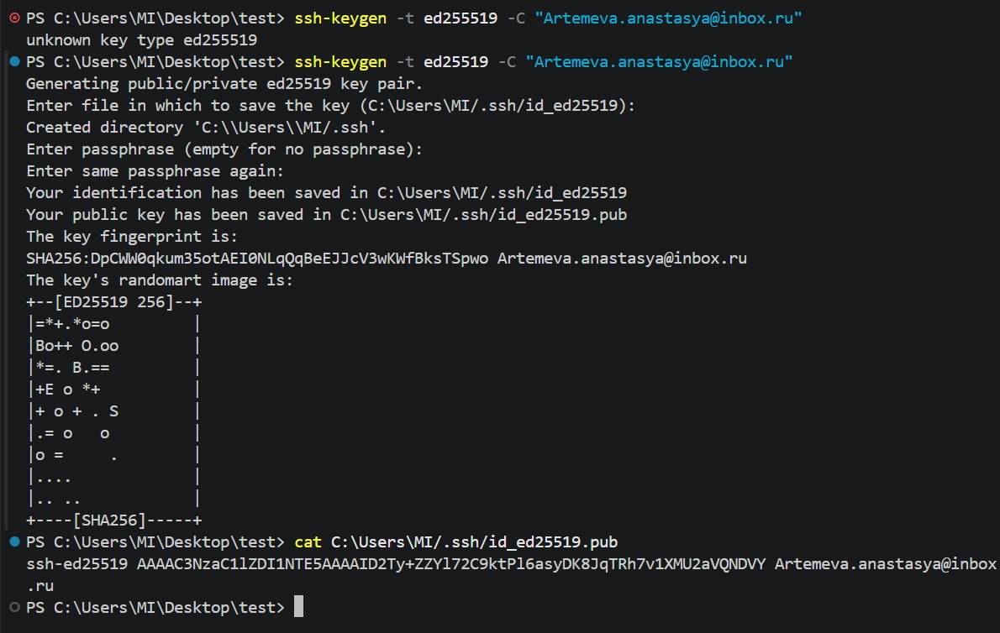
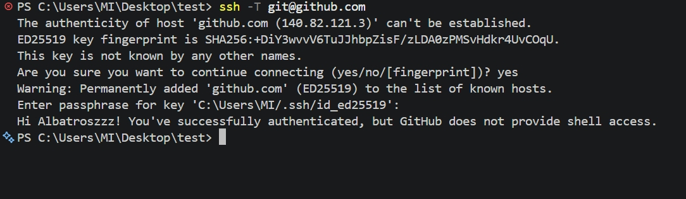

# Отчёт по домашнему заданию: SSH и работа с GitHub

## 1. Установка SSH-клиента и генерация ключевой пары
В терминале выполнена команда генерации ключа типа ed25519:
`ssh-keygen -t ed25519 -C "artemeva.anastasya@inbox.ru"`

Приватный ключ защищён кодовой фразой (passphrase).

---

## 2. Добавление публичного ключа в аккаунт GitHub
Содержимое файла `~/.ssh/id_ed25519.pub` добавлено в настройки профиля GitHub (Settings -> SSH and GPG keys).

---

## 3. Проверка SSH-подключения к GitHub
Выполнена проверка подключения командой:
`ssh -T git@github.com`

Соединение успешно установлено, получено приветствие от GitHub.

---

## 4. Работа с репозиторием по SSH
Репозиторий скопирован по SSH-URL (`git@github.com:ваш_логин/ваш_репозиторий.git`).
Внесены изменения, создан коммит и выполнен отправка (`git push`).
Операция прошла успешно без ввода пароля от учетной записи.

![Клонирование и git push] (4.jpg)
fff